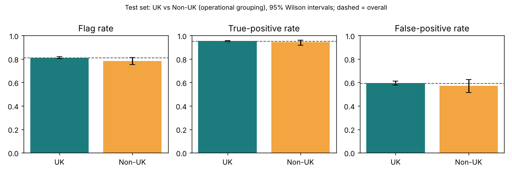

# Fairness Metrics Report: 90-Day Churn Model v1.0.0

**Project:** Retail Analytics Decision Support Platform · **Model:** `churn_logreg` v1.0.0 · **Author:** Bezzel Chitsungo · **Companion documents:** Model Validation Report (§6), Model Card.

> **Read this first.** The dataset has **no protected attributes**, and none were inferred. Country is an operational field, not a protected attribute. The analysis below uses **UK vs non-UK** as a *supplementary operational grouping* only, so that the Module 1 commitment to examine country variables for proxy effects is not ignored. **It does not satisfy a protected-attribute fairness requirement.** That requirement is **unmet and pending instructor clarification** (draft request: `docs/instructor_clarification_request_DRAFT.md`, not sent). Nothing in this report claims the model is fair or that bias has been eliminated.

> **Statement.** Protected attributes as defined by the Equality Act 2010 and the assignment brief are not present in Online Retail II and were not inferred. Therefore a formal protected-attribute fairness analysis is not possible on this dataset. Requirement recorded as unmet due to data limitation.

> Groupings used below are labelled as follows. `geographic_grouping_for_robustness_check`: UK vs non-UK, an operational grouping and **not** a protected characteristic. `customer-segment audit`: tenure, spend and purchase-frequency tiers, which are **behavioural, not demographic**. No synthetic protected attribute was created and no other dataset was used.

## 1. Setup

* **Positive prediction:** flagged for a retention offer (probability ≥ 0.345328, the threshold that maximises F1 on validation).
* **Outcome and eligibility:** Churn definition agreed with Marketing: churn = no sales invoice (purchase) in the 90 days following the observation date, with the customer eligible only if they had at least 180 days of prior history (first sales invoice at least 180 days before the observation date). Agreed with the Marketing Director on 1 November 2026 (confirmed by email from the Marketing Director, 1 November 2026).
* **Groups:** UK (`United Kingdom`) and Non-UK (all other countries). Group membership is held out of the predictors; an ablation shows a UK flag changes validation AUC by less than 0.0001.
* **Units:** customer-snapshot rows. Rows from one customer are correlated, so every interval is a **customer-clustered bootstrap** (95%); proportions use Wilson intervals.
* **Minimum group size:** 100 rows; smaller groups are tabulated but flagged and not interpreted.
* **Governance thresholds** (programme choices, not statistical or legal tests): disparate impact ratio within 0.80–1.25 (Module 2); group TPR and FPR within ±10% of overall (Module 1).

## 2. Metric definitions

| Metric | Definition (Non-UK relative to UK unless stated) |
|---|---|
| Demographic parity difference (DPD) | selection rate(Non-UK) − selection rate(UK) |
| Disparate impact ratio (DI) | selection rate(Non-UK) ÷ selection rate(UK) |
| TPR difference | recall(Non-UK) − recall(UK) |
| FPR difference | false positive rate(Non-UK) − false positive rate(UK) |
| Equalised-odds difference | larger of the absolute TPR difference and absolute FPR difference |
| TPR or FPR vs overall | group rate ÷ overall rate (band 0.90–1.10) |

## 3. Pre-declared validation gate (used for model selection)

| Candidate | DI ratio | TPR vs overall | FPR vs overall | Passes gate |
|---|---|---|---|---|
| logreg | 0.937 | 0.998 | 0.903 | True |
| lightgbm | 0.945 | 1.010 | 0.887 | False |
| random_forest | 0.957 | 1.018 | 0.910 | True |

*Table 1. Validation gate (Mar–Apr 2011). Logistic regression and the random forest passed and LightGBM did not (FPR ratio 0.887, below the 0.90 limit). Logistic regression passed narrowly (FPR ratio 0.903), so selection followed the interpretability rule and mitigation was not triggered.*

## 4. Test-set results for the selected model (final run; see the test-use disclosure in the Validation Report §7)

| Group | Rows | Churn rate | Selection rate (95% CI) | TPR (95% CI) | FPR (95% CI) |
|---|---|---|---|---|---|
| UK | 8,228 | 0.606 | 0.812 (0.803–0.820) | 0.953 (0.947–0.959) | 0.594 (0.577–0.611) |
| Non-UK | 715 | 0.573 | 0.785 (0.753–0.813) | 0.944 (0.917–0.962) | 0.570 (0.514–0.625) |
| Overall | 8,943 | 0.603 | 0.809 | 0.953 | 0.592 |

*Table 2. Group rates on test (Wilson 95% intervals).*

| Comparison | Value | 95% CI (cluster bootstrap) | Governance band | Within band? |
|---|---|---|---|---|
| DPD | -0.027 | (-0.073, +0.013) | n/a | n/a |
| Disparate impact ratio | 0.967 | (0.910, 1.016) | 0.80–1.25 | True |
| TPR difference | -0.009 | (-0.039, +0.015) | n/a | n/a |
| FPR difference | -0.024 | (-0.103, +0.051) | n/a | n/a |
| Equalised-odds difference | 0.024 | derived from the two rows above | n/a | n/a |
| TPR vs overall | 0.991 | n/a | 0.90–1.10 | True |
| FPR vs overall | 0.963 | n/a | 0.90–1.10 | True |

*Table 3. Fairness metrics on test. Calibration (Brier) by group: UK 0.172, Non-UK 0.168.*

**Findings.** Selection rates, recall and false-alarm rates are comparable (DI 0.967 is inside the band; the DPD, TPR and FPR intervals all include zero). The non-UK false positive rate is 0.024 lower than the UK rate, with a ratio to the overall rate of 0.963, inside the Module 1 band. Because the interval is wide (715 non-UK rows) the size of any gap is uncertain, so this is not evidence that the groups are treated the same. A higher non-UK false-alarm rate (+0.075) seen under the earlier eligibility rule was not reproduced under the rule agreed with Marketing, and it is not claimed to be eliminated. The non-UK group also has a different base churn rate (0.573 vs 0.606), and when base rates differ, a classifier that is not perfect generally cannot equalise selection rates and error rates at the same time.

**Direction of harm.** A flag triggers a retention offer, so a false positive means an unnecessary offer. Whether that is a benefit, a cost to the company or a crowding-out of other customers depends on how Marketing uses the list. This is an open question for the business, not something the model can settle.

## 5. Mitigation experiments

Two mitigations were run **after** the validation gate passed, as exploratory work. Both were fitted on training/validation only. Their test results were computed for transparency and **were not used to choose a model**; they are, however, further looks at the test period and are counted in the disclosure in the Validation Report (§7). **Neither was adopted.**

| Approach | Test recall | Test flag rate | Test DI | Test FPR vs overall | Test EO difference | Test AUC |
|---|---|---|---|---|---|---|
| M0 unmitigated (deployed) | 0.953 | 0.809 | 0.967 | 0.963 | 0.024 | 0.810 |
| M1 equalised-odds thresholds | 0.880 | 0.701 | 0.961 | 1.070 | 0.047 | n/a (group-specific thresholds) |
| M2 reweighing + refit | 0.952 | 0.809 | 0.965 | 0.958 | 0.027 | 0.810 |

*Table 4. Before/after on test (exploratory). M1 thresholds were fitted on validation, so validation figures for M1 are in-sample and omitted here.*

With no governance band breached on test, neither mitigation was needed. M1 reduced recall from 0.953 to 0.880 by using group-specific thresholds (which also raises its own governance questions) and increased the equalised-odds difference from 0.024 to 0.047; M2 left the results essentially unchanged. The deployed model is unmitigated. **Residual risk is carried into the monitoring plan.** Choosing between M0, M1 and M2 on the test results would be tuning on test and was not done.

**Disclosure statement.** On test the non-UK false-alarm rate is 0.570 against 0.594 for the UK (difference -0.024, 95% CI -0.103 to 0.051; ratio to overall 0.963), inside the ±10% band set in Module 1, and the equalised-odds difference is 0.024. On validation the ratio was 0.903, only just inside the 0.90 lower limit. The higher non-UK false-alarm rate seen under the earlier eligibility rule (+0.075) was not reproduced under the agreed rule, and I do not claim the disparity is eliminated. Two mitigation attempts, group-specific equalised-odds thresholds and Kamiran-Calders reweighing, were run as exploratory checks; neither improved on the unmitigated model and neither was adopted.

## 6. Per-country detail (informational)

Only groups with at least 100 rows are interpreted. Others are shown to document coverage, not to support conclusions.

| Country | Rows | Selection rate | TPR | FPR | Sufficient n |
|---|---|---|---|---|---|
| United Kingdom | 8228 | 0.812 | 0.953 | 0.594 | True |
| Germany | 146 | 0.671 | 0.933 | 0.488 | True |
| France | 105 | 0.629 | 0.929 | 0.429 | True |
| Spain | 47 | 0.851 | 0.964 | 0.684 | False |
| Netherlands | 44 | 0.886 | 0.970 | 0.636 | False |
| Belgium | 37 | 0.676 | 0.789 | 0.556 | False |
| Portugal | 34 | 0.853 | 0.885 | 0.750 | False |
| Sweden | 32 | 0.844 | 1.000 | 0.286 | False |
| Switzerland | 29 | 0.931 | 1.000 | 0.882 | False |
| Australia | 28 | 0.821 | 1.000 | 0.583 | False |
| Italy | 25 | 0.920 | 1.000 | 0.714 | False |
| Channel Islands | 22 | 0.864 | 0.938 | 0.667 | False |

*Table 5. Largest 12 of 40 countries by test rows (full table in `reports/model/final_test_results.json`). Rates for groups marked False are unreliable.*

## 7. Supplementary B: customer-segment audit (behavioural)

Tiers are tertiles of tenure (days since first purchase), spend (revenue, all history) and purchase frequency (invoices, all history), with cut-offs fixed on the **training** snapshots only (tenure 227 / 277 days; spend GBP 572 / 1,642; frequency 2 / 5 invoices). This is an exploratory, descriptive audit of the recorded test predictions: the model, threshold and decision rule were not changed, and it is a further look at the test period that is counted in the test-use disclosure. Intervals are Wilson 95% intervals. Source: `scripts/segment_audit.py`, output `reports/model/segment_audit.json`.

| Segment variable | Tier | n | Lapse rate | Flag rate | Lapsers caught (TPR) [95% CI] | False-alarm rate (FPR) [95% CI] |
|---|---|---|---|---|---|---|
| Tenure | Low | 293 | 0.676 | 0.846 | 0.960 [0.922, 0.979] | 0.611 [0.510, 0.702] |
| Tenure | Mid | 560 | 0.750 | 0.929 | 0.976 [0.957, 0.987] | 0.786 [0.711, 0.846] |
| Tenure | High | 8,090 | 0.590 | 0.800 | 0.950 [0.944, 0.956] | 0.583 [0.567, 0.600] |
| Spend | Low | 3,341 | 0.842 | 1.000 | 1.000 [0.999, 1.000] | 0.998 [0.989, 1.000] |
| Spend | Mid | 2,614 | 0.634 | 0.954 | 0.977 [0.969, 0.983] | 0.915 [0.896, 0.931] |
| Spend | High | 2,988 | 0.309 | 0.470 | 0.764 [0.735, 0.790] | 0.338 [0.318, 0.359] |
| Purchase frequency | Low | 3,739 | 0.835 | 1.000 | 1.000 [0.999, 1.000] | 1.000 [0.994, 1.000] |
| Purchase frequency | Mid | 2,405 | 0.612 | 0.978 | 0.992 [0.986, 0.995] | 0.955 [0.940, 0.966] |
| Purchase frequency | High | 2,799 | 0.285 | 0.411 | 0.694 [0.661, 0.725] | 0.298 [0.278, 0.318] |

*Behavioural segments, not demographic and not protected.*

**What it shows.** Segments differ sharply, and that is expected because the model scores behaviour. In the lowest-frequency tier (two or fewer invoices) and the lowest-spend tier the fixed threshold flags everyone (flag rate 1.000 in both; false-alarm rate 1.000 and 0.998), so inside those tiers the flag does not separate lapsers from customers who stayed. In the highest-frequency and highest-spend tiers the model flags fewer customers (flag rate 0.411 and 0.470) and catches fewer lapsers (TPR 0.694 and 0.764), which matters because those are the customers a retailer would most want to keep. The Module 1 bands were set for group comparisons and are not applied to these tiers. No claim of fairness or unfairness is made; the point is that a single threshold behaves very differently across customer types and Marketing should review it by segment.

## 8. What this analysis cannot show

1. **Protected-attribute fairness.** Protected attributes as defined by the Equality Act 2010 and the assignment brief are not present in Online Retail II and were not inferred. Therefore a formal protected-attribute fairness analysis is not possible on this dataset. Requirement recorded as unmet due to data limitation.
2. **Individual fairness** and **causal** questions (would the same customer be treated differently in another country?) are out of scope.
3. **Intersectional or per-country conclusions:** groups are too small.
4. **Time.** A single test window and a churn rate that differs between periods (0.47 training, 0.62 validation, 0.60 test) limit how far these numbers will carry forward.
5. The 90-day churn window and the eligibility rule (at least 180 days of prior history) were agreed with the Marketing Director on 1 November 2026 (confirmed by email from the Marketing Director). A different window or rule changes labels and therefore every metric above. The rule admits customers who have not bought for a long time, so the false-alarm rate is high for the whole population (0.59 overall).

## 9. Reproducing these numbers

`PYTHONPATH=src python -m churn_model.final_eval` produces `reports/model/final_test_results.json` (the source of Tables 2, 3 and 5), and `python -m churn_model.mitigation` produces `reports/model/mitigation_results.json` (Table 4), and `python scripts/segment_audit.py` produces `reports/model/segment_audit.json` (Section 7). Both log to MLflow experiment `retail-churn-90d`. Re-running `final_eval` scores the test set again and must be disclosed as such.
