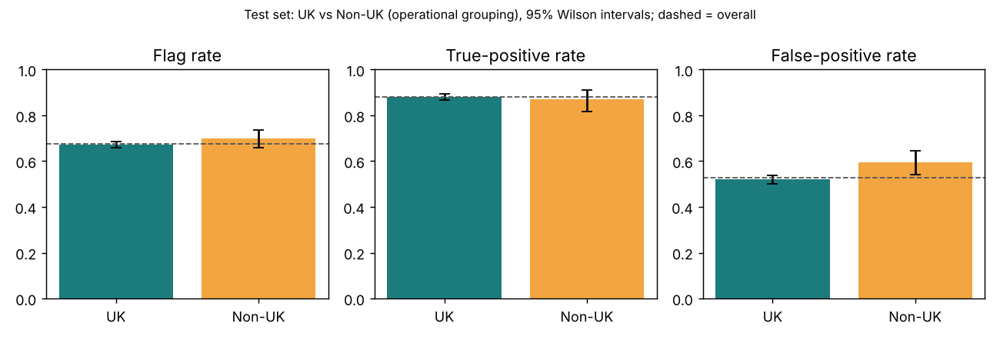

# Fairness Metrics Report: 90-Day Churn Model v1.0.0

**Project:** Retail Analytics Decision Support Platform · **Model:** `churn_logreg` v1.0.0 · **Author:** Bezzel Chitsungo · **Companion documents:** Model Validation Report (§6), Model Card.

> **Read this first.** The dataset has **no protected attributes**, and none were inferred. Country is an operational field, not a protected attribute. The analysis below uses **UK vs non-UK** as a *supplementary operational grouping* only, so that the Module 1 commitment to examine country variables for proxy effects is not ignored. **It does not satisfy a protected-attribute fairness requirement.** That requirement is **unmet and pending instructor clarification** (draft request: `docs/instructor_clarification_request_DRAFT.md`, not sent). Nothing in this report claims the model is fair or that bias has been eliminated.

## 1. Setup

* **Positive prediction:** flagged for a retention offer (probability ≥ 0.313903, the threshold that maximises F1 on validation).
* **Outcome:** churn = no sales invoice in the 90 days after the prediction date (window PROPOSED, pending Marketing).
* **Groups:** UK (`United Kingdom`) and Non-UK (all other countries). Group membership is held out of the predictors; an ablation shows a UK flag changes validation AUC by 0.0002.
* **Units:** customer-snapshot rows. Rows from one customer are correlated, so every interval is a **customer-clustered bootstrap** (95%); proportions use Wilson intervals.
* **Minimum group size:** 100 rows; smaller groups are tabulated but flagged and not interpreted.
* **Governance thresholds** (programme choices, not statistical or legal tests): disparate impact ratio within 0.80–1.25 (Module 2); group TPR and FPR within ±10% of overall (Module 1).

## 2. Metric definitions

| Metric | Definition (Non-UK relative to UK unless stated) |
|---|---|
| Demographic parity difference (DPD) | selection rate(Non-UK) − selection rate(UK) |
| Disparate impact ratio (DI) | selection rate(Non-UK) ÷ selection rate(UK) |
| TPR difference | recall(Non-UK) − recall(UK) |
| FPR difference | false positive rate(Non-UK) − false positive rate(UK) |
| Equalised-odds difference | larger of the absolute TPR difference and absolute FPR difference |
| TPR or FPR vs overall | group rate ÷ overall rate (band 0.90–1.10) |

## 3. Pre-declared validation gate (used for model selection)

| Candidate | DI ratio | TPR vs overall | FPR vs overall | Passes gate |
|---|---|---|---|---|
| logreg | 1.007 | 1.031 | 1.002 | True |
| lightgbm | 0.979 | 1.022 | 0.942 | True |
| random_forest | 0.982 | 1.036 | 0.923 | True |

*Table 1. Validation gate (Mar–Apr 2011). All candidates passed, so selection followed the interpretability rule and mitigation was not triggered.*

## 4. Test-set results for the selected model (scored once for this iteration)

| Group | Rows | Churn rate | Selection rate (95% CI) | TPR (95% CI) | FPR (95% CI) |
|---|---|---|---|---|---|
| UK | 5,002 | 0.422 | 0.673 (0.660–0.686) | 0.882 (0.868–0.895) | 0.520 (0.502–0.538) |
| Non-UK | 532 | 0.378 | 0.699 (0.659–0.737) | 0.871 (0.817–0.910) | 0.595 (0.541–0.647) |
| Overall | 5,534 | 0.418 | 0.676 | 0.881 | 0.528 |

*Table 2. Group rates on test (Wilson 95% intervals).*

| Comparison | Value | 95% CI (cluster bootstrap) | Governance band | Within band? |
|---|---|---|---|---|
| DPD | +0.026 | (-0.025, +0.081) | n/a | n/a |
| Disparate impact ratio | 1.039 | (0.963, 1.122) | 0.80–1.25 | True |
| TPR difference | -0.012 | (-0.070, +0.048) | n/a | n/a |
| FPR difference | +0.075 | (+0.009, +0.145) | n/a | n/a |
| Equalised-odds difference | 0.075 | derived from the two rows above | n/a | n/a |
| TPR vs overall | 0.988 | n/a | 0.90–1.10 | True |
| FPR vs overall | 1.127 | n/a | 0.90–1.10 | **False** |

*Table 3. Fairness metrics on test. Calibration (Brier) by group: UK 0.192, Non-UK 0.205.*

**Findings.** Selection rates and recall are comparable (DI 1.039 is inside the band; the DPD and TPR intervals include zero). The **non-UK false positive rate is 0.075 higher**; its interval (0.009 to 0.145) just excludes zero and its ratio to the overall rate (1.127) is outside the Module 1 band. Because the interval is wide (532 non-UK rows) the size of the gap is uncertain; the finding is a flag for review, not proof of unfair treatment. The non-UK group also has a different base churn rate (0.378 vs 0.422), and when base rates differ, a classifier that is not perfect generally cannot equalise selection rates and error rates at the same time.

**Direction of harm.** A flag triggers a retention offer, so a false positive means an unnecessary offer. Whether that is a benefit, a cost to the company or a crowding-out of other customers depends on how Marketing uses the list. This is an open question for the business, not something the model can settle.

## 5. Mitigation experiments

Two mitigations were run **after** the validation gate passed, as exploratory work. Both were fitted on training/validation only. Their test results were computed for transparency and **were not used to choose a model**; they are, however, further looks at the test period and are counted in the disclosure in the Validation Report (§7). **Neither was adopted.**

| Approach | Test recall | Test flag rate | Test DI | Test FPR vs overall | Test EO difference | Test AUC |
|---|---|---|---|---|---|---|
| M0 unmitigated (deployed) | 0.881 | 0.676 | 1.039 | 1.127 | 0.075 | 0.765 |
| M1 equalised-odds thresholds | 0.755 | 0.525 | 1.049 | 1.199 | 0.080 | n/a (group-specific thresholds) |
| M2 reweighing + refit | 0.891 | 0.688 | 1.057 | 1.142 | 0.086 | 0.765 |

*Table 4. Before/after on test (exploratory). M1 thresholds were fitted on validation, so validation figures for M1 are in-sample and omitted here.*

Neither approach brought the FPR ratio inside the band (M1 1.199, M2 1.142 vs 1.127 unmitigated), and M1 reduced recall from 0.881 to 0.755 by using group-specific thresholds, which also raises its own governance questions. Because the validation gate passed and the mitigations did not help on test, the deployed model is unmitigated. **The residual disparity is disclosed and carried into the monitoring plan.** Choosing between M0, M1 and M2 on the test results would be tuning on test and was not done.

## 6. Per-country detail (informational)

Only groups with at least 100 rows are interpreted. Others are shown to document coverage, not to support conclusions.

| Country | Rows | Selection rate | TPR | FPR | Sufficient n |
|---|---|---|---|---|---|
| United Kingdom | 5002 | 0.673 | 0.882 | 0.520 | True |
| Germany | 123 | 0.618 | 0.921 | 0.482 | True |
| France | 108 | 0.639 | 0.852 | 0.568 | False |
| Belgium | 40 | 0.650 | 0.818 | 0.586 | False |
| Spain | 38 | 0.816 | 0.941 | 0.714 | False |
| Switzerland | 26 | 0.846 | 1.000 | 0.750 | False |
| Portugal | 18 | 0.611 | 0.727 | 0.429 | False |
| Netherlands | 14 | 0.643 | 0.800 | 0.556 | False |
| Australia | 13 | 0.692 | 1.000 | 0.636 | False |
| Channel Islands | 12 | 0.667 | 0.600 | 0.714 | False |
| Austria | 12 | 1.000 | 1.000 | 1.000 | False |
| Sweden | 12 | 0.667 | 1.000 | 0.429 | False |

*Table 5. Largest 12 of 34 countries by test rows (full table in `reports/model/final_test_results.json`). Rates for groups marked False are unreliable.*

## 7. What this analysis cannot show

1. **Protected-attribute fairness.** No protected attributes exist. The brief requires formal analysis of them; that cannot be done honestly with these data (see the draft clarification request).
2. **Individual fairness** and **causal** questions (would the same customer be treated differently in another country?) are out of scope.
3. **Intersectional or per-country conclusions:** groups are too small.
4. **Time.** A single test window and a prevalence shift (0.57 validation vs 0.42 test) limit how far these numbers will carry forward.
5. The 90-day churn window is PROPOSED. A different window changes labels and therefore every metric above.

## 8. Reproducing these numbers

`PYTHONPATH=src python -m churn_model.final_eval` produces `reports/model/final_test_results.json` (the source of Tables 2, 3 and 5), and `python -m churn_model.mitigation` produces `reports/model/mitigation_results.json` (Table 4). Both log to MLflow experiment `retail-churn-90d`. Re-running `final_eval` scores the test set again and must be disclosed as such.
