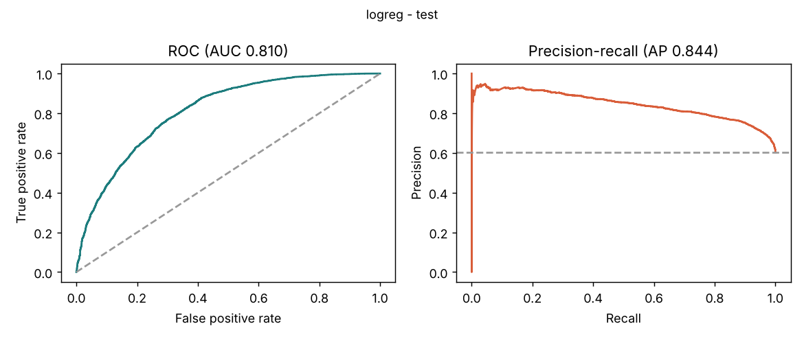
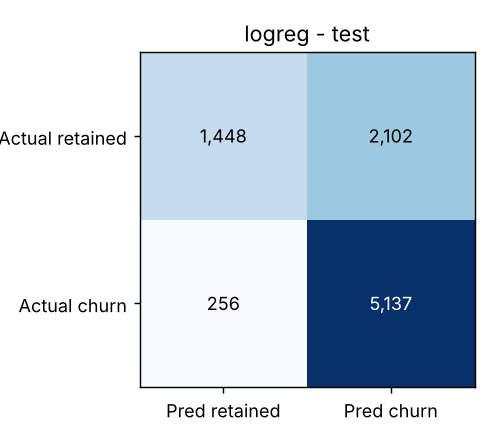
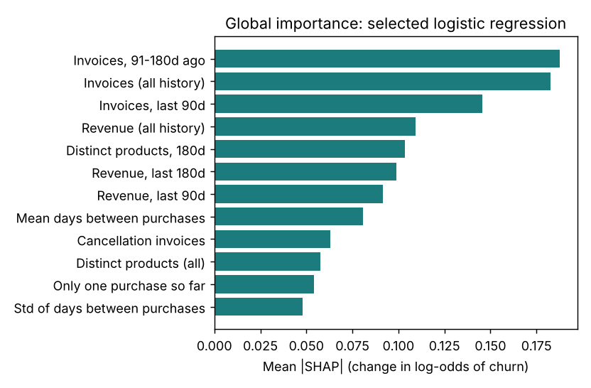
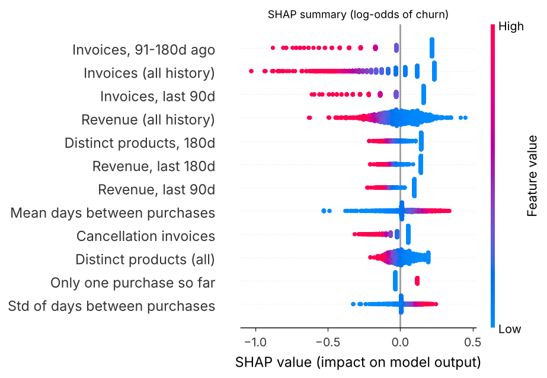
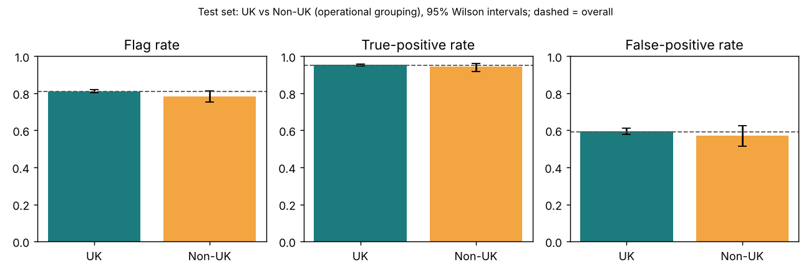

# Model Validation Report: 90-Day Customer Churn Model (v1.0.0)

**Project:** Retail Analytics Decision Support Platform (Online Retail II)

**Course:** BAN 6800, Nexford University

**Author:** Bezzel Chitsungo (MSc Data Analytics)

**Model:** `churn_logreg` v1.0.0

## 1. Purpose and business need

The Module 1 charter set a retention target: a five-percentage-point rise in repeat purchases within twelve months. Marketing currently builds campaigns from RFM segments, which describe past value but do not rank who is about to lapse. A churn-risk score gives retention planners a ranked list to review before they spend offer budget.

The model is decision *support*: it ranks identified customers for human-reviewed retention planning. It must not drive automated decisions about individuals, and it covers neither guest customers nor customers with fewer than 180 days of purchase history.

## 2. Task definition and data

The dataset is the Module 3 published fact table (build `41afeb4d5b118509`), derived from the Online Retail II transactions (Chen, 2019), which holds pseudonymised customer keys. Pseudonymised data is pseudonymous, not anonymous, and is treated as personal data throughout.

**Task (windows agreed).** The Module 2 plan left the churn window and eligibility rule "to be agreed with Marketing". The Marketing Director confirmed by email on 1 November 2026 a 90-day prediction (churn) window and an eligibility rule that customers must have at least 180 days of prior history, with the 180 days treated as an eligibility criterion for inclusion in the modelling dataset and not as the churn window. Every result below depends on them. At a monthly prediction date *T*, an identified customer is eligible if their first sales invoice is at least 180 days before *T*. The label is churn = 1 when the customer places **no sales invoice in the 90 days from T**. Features use only data before *T*. Eligibility does not require recent activity, so the population includes customers who have not bought for a long time; Section 4 reports how much of the headline performance comes from them.

**Target construction and censoring.** Data end on 9 December 2011, so the last prediction date with a complete 90-day outcome window is 1 September 2011. Later dates are never created. Incomplete follow-up is therefore never labelled as churn. The result is 46,200 customer-snapshot rows from 4,538 customers over 16 monthly dates (a customer appears at every date after becoming eligible). Rows from one customer are not independent, so bootstrap intervals are clustered by customer.

**Features.** There are 18 behavioural features: recency, tenure, invoice counts over several windows, revenue over several windows, product breadth, purchase-gap statistics, and cancellation history. Country, the customer key and the snapshot date are excluded from the predictors and kept only for evaluation. Three gap features are missing for customers with a single invoice (21% to 26% of rows) and are imputed with training medians inside the pipeline.

**Churn definition (agreed).** Churn definition agreed with Marketing: churn = no sales invoice (purchase) in the 90 days following the observation date, with the customer eligible only if they had at least 180 days of prior history (first sales invoice at least 180 days before the observation date). Agreed with the Marketing Director on 1 November 2026 (confirmed by email from the Marketing Director, 1 November 2026).

## 3. Evaluation protocol and leakage controls

| Split | Prediction dates | Rows | Customers | Churn rate |
|---|---|---|---|---|
| Train | Jun–Dec 2010 | 11,699 | 2,714 | 0.466 |
| Validation | Mar–Apr 2011 | 6,885 | 3,573 | 0.622 |
| Test | Aug–Sep 2011 | 8,943 | 4,538 | 0.603 |

*Table 1. Time-ordered splits. Gaps equal the 90-day horizon so an outcome window never overlaps the next split.*

Time-ordered splits stop the model from learning from the future. Models were built with scikit-learn (Pedregosa et al., 2011). Hyperparameters were searched with randomised search (25 draws, ROC-AUC) over four expanding-window folds inside the training period, with a three-month purge between fold train and fold validation. Imputation, scaling, class weighting and tuning are fitted inside each training fold only. Automated tests confirm that perturbing invoices dated on or after *T* leaves features unchanged and that adding a future purchase flips the label.

The selection rule was fixed in advance: take the highest validation AUC; if a more interpretable candidate is within 0.005 AUC, prefer it (logistic regression, then LightGBM, then random forest); then apply a fairness gate on validation. The threshold maximises F1 on validation. The test period was never used for tuning; Section 7 discloses how often it was scored. The selected model is saved as a joblib file and registered in the MLflow Model Registry (`retail-churn-logreg`, alias `champion`); the alias marks the version the API serves, not production approval.

## 4. Models and results

I compared two baselines and three candidates. The prevalence baseline flags everyone. The business baseline is a recency rule (longer since last purchase, higher risk), representing what a planner would do without a model.

| Model | Validation AUC | Test AUC (95% CI) | Test PR-AUC | Test F1 | Test Brier |
|---|---|---|---|---|---|
| Prevalence | 0.500 | 0.500 (0.500–0.500) | 0.603 | 0.752 | 0.258 |
| Recency rule | 0.760 | 0.757 (0.744–0.769) | 0.782 | 0.786 | 0.217 |
| **Logistic regression (selected)** | 0.805 | **0.810 (0.798–0.821)** | 0.844 | 0.813 | 0.172 |
| LightGBM | 0.791 | 0.806 (0.793–0.817) | 0.843 | 0.798 | 0.173 |
| Random forest | 0.808 | 0.816 (0.804–0.826) | 0.853 | 0.809 | 0.172 |

*Table 2. Validation and test performance. Intervals are customer-clustered bootstrap (95%). Thresholds were set on validation.*

Logistic regression and the random forest are within 0.003 AUC on validation, LightGBM is 0.014 lower, and the test intervals of all three overlap, so they are statistically indistinguishable. The pre-declared interpretability rule therefore selects logistic regression (`C = 0.0014`, no class weighting), which passed the validation fairness gate (Section 6). On test the random forest scored 0.006 AUC higher (0.816 against 0.810); that is within the intervals and the rule was fixed before test, so it was not used to change the selection. The selected model improves on the recency rule by about 0.05 AUC, and the intervals do not overlap. At the validation threshold of 0.345 the model has test precision 0.710 and recall 0.953 and flags 80.9% of customer-snapshots. Because 60.3% of test rows churn, a precision of 0.710 is a lift of only 1.18 over flagging everyone at random, and a threshold that maximises F1 at this prevalence flags almost everyone. Mean predicted churn (0.571) is three points below the observed rate (0.603).

I report ROC-AUC because it measures ranking quality independently of any threshold, which a prioritised list needs. PR-AUC, precision, recall and F1 show the cost of a particular cut-off, and the Brier score checks the probabilities. Calibration is good on average, but I did not recalibrate, so probabilities are relative risk, not guaranteed frequencies, when the churn rate moves.

Cross-validation AUC inside the training period was lower (0.767, standard deviation 0.024) than on validation (0.805). This is expected: the earliest folds train on only one or two months of history, whereas the final model sees seven, so the cross-validation figure should not be quoted as expected performance.

Figure 2 shows the cost of the validation threshold on the test set: 5,137 of 5,393 churners are caught, at the price of 2,102 retained customers flagged. I favoured recall because a missed churner is a lost customer, while an unnecessary offer costs only a discount, so the threshold maximises F1 on validation and leans toward recall (0.95).

The churn rate was 0.466 in the training period, 0.622 on validation and 0.603 on test, so the threshold chosen on validation transfers reasonably to test but would not if prevalence moved again. Marketing should set the flag rate from campaign capacity, and Table 3 gives descriptive operating points (not tuned on test).

| Flag rate | Precision | Recall | Lift |
|---|---|---|---|
| 20% | 0.899 | 0.298 | 1.49 |
| 40% | 0.841 | 0.558 | 1.39 |
| 60% | 0.788 | 0.784 | 1.31 |

*Table 3. Test operating points at fixed flag rates (descriptive only).*

Performance is weaker for customers not seen in training (AUC 0.772, n = 1,797 rows) than for returning customers (0.816, n = 7,146). The two test dates give 0.823 and 0.801. With one test window, behaviour under a regime change is unknown.

**Where the headline comes from.** Eligibility no longer requires a recent purchase, so 4,807 of the 8,943 test rows (54%) are customers with no purchase in the 180 days before the prediction date. Of these, 80.4% churned, and the model flags 99.9% of them, so for this group the flag carries almost no information beyond "has not bought recently" (AUC 0.655, false-alarm rate 1.000). Among the 4,136 rows where the customer also bought in the prior 180 days (the narrower population used before 1 November 2026), churn is 36.9%, AUC is 0.768 (0.750–0.786), precision is 0.523 and recall 0.836. Table 3b shows both groups. It is a descriptive look at the recorded test predictions (`scripts/active_subset_check.py`; counted in the test-use disclosure in Section 7) and the model, threshold and decision rule were not changed.

| Test subset | Rows | Churn rate | AUC (95% CI) | Precision | Recall | False-alarm rate | Flag rate |
|---|---|---|---|---|---|---|---|
| All eligible | 8,943 | 0.603 | 0.810 (0.798–0.821) | 0.710 | 0.953 | 0.592 | 0.809 |
| Bought in prior 180 days | 4,136 | 0.369 | 0.768 (0.750–0.786) | 0.523 | 0.836 | 0.445 | 0.589 |
| No purchase in prior 180 days | 4,807 | 0.804 | 0.655 (0.629–0.678) | 0.804 | 0.998 | 1.000 | 0.999 |

*Table 3b. Test performance by whether the customer also bought in the 180 days before the prediction date (descriptive).*

## 5. Interpretability

SHAP values (Lundberg & Lee, 2017) for the logistic regression were computed on the log-odds scale for 2,000 random test rows, with a 500-row training background.

Purchase frequency dominates. By group, frequency contributes 0.47, spend 0.26, product breadth 0.14, regularity 0.12, cancellations 0.07, recency 0.06 and tenure 0.05 (mean absolute summed SHAP, log-odds). Recency matters little on its own because the invoice counts for the last 30, 90 and 91 to 180 days already encode it. Figure 4 shows the direction: customers with many past invoices and high revenue (red dots, left) score as low risk. One direction needs care: longer tenure raises predicted risk. Tenure is strongly nested with, and correlated with, the other features, so single-feature directions are conditional and should not be read as causes.

A LightGBM model gives a different ordering (rank correlation 0.28, two of five top features shared). Rankings are therefore indicative.

Five local cases were chosen by a deterministic rule, not by hand. Case C is the most confident false positive (0.86): a customer with a single small invoice, 512 days before the prediction date, who then bought again within 90 days. Case D is the least confident missed churner (0.074): 31 invoices and about £22,969 of revenue, who did not return. Strong history lowers risk but never removes it.

**Counterfactuals.** I searched only mutable behaviour (extra invoices, up to six, and the date of the latest purchase) and held tenure, product breadth, gap statistics, cancellations and country fixed. With only 36 scenarios, a direct grid search replaced DiCE or Alibi, and every counterfactual was re-scored through the pipeline. Both reported flagged cases that flip do so (0.734 to 0.340 with six extra invoices, the latest 14 days before the prediction date; 0.345 to 0.257 with one extra invoice, the latest 90 days before). Case C does not flip within six extra invoices. Across 300 sampled flagged customers, 63.7% flip within six extra invoices, the median is four, and 16% need one. These describe the model's response, not what would make a customer stay.

**Sensitivity.** Monetary noise (σ up to 0.2) and recency shifts of ±7 days change AUC by at most 0.0002. Randomly missing values in five features lower AUC by 0.0004 (5%), 0.0006 (10%) and 0.0009 (20%). Removing cancellation history changes AUC by +0.0001. This says nothing about behavioural drift.

## 6. Fairness assessment

**What the data can and cannot support.** The dataset contains no protected attributes (no age, sex, ethnicity, disability or similar), and I have not inferred any. Country is an operational field, not a protected attribute. The Module 1 charter, in line with ICO (2020) guidance on fairness in AI, asks that country variables be examined for proxy effects and that subgroup recall and error rates stay within 10% of overall. I therefore use **UK versus non-UK** customers as a *supplementary, operational* grouping. This does **not** satisfy a protected-attribute fairness requirement, which remains **unmet and pending instructor clarification** (Appendix B). Positive prediction means "flagged for a retention offer".

**Statement.** Protected attributes as defined by the Equality Act 2010 and the assignment brief are not present in Online Retail II and were not inferred. Therefore a formal protected-attribute fairness analysis is not possible on this dataset. Requirement recorded as unmet due to data limitation.

Groupings used below are labelled as follows. `geographic_grouping_for_robustness_check`: UK vs non-UK, an operational grouping and **not** a protected characteristic. `customer-segment audit`: tenure, spend and purchase-frequency tiers, which are **behavioural, not demographic**. No synthetic protected attribute was created and no other dataset was used.

An ablation shows the model does not need country: adding a UK flag changes validation AUC by less than 0.0001, so it is excluded.

The Module 1 ±10% band and the Module 2 disparate-impact band (0.80–1.25) are governance thresholds, not statistical or legal tests. I therefore report each metric with an interval and read a breach as a prompt for review, not proof of unfair treatment.

| Metric (test) | UK (n = 8,228) | Non-UK (n = 715) | Difference or ratio (95% CI) |
|---|---|---|---|
| Selection rate | 0.812 | 0.785 | DPD −0.027 (−0.073, 0.013) |
| Disparate impact ratio | – | – | 0.967 (0.910, 1.016) |
| True positive rate | 0.953 | 0.944 | −0.009 (−0.039, 0.015) |
| False positive rate | 0.594 | 0.570 | −0.024 (−0.103, 0.051) |
| Equalised-odds difference | – | – | 0.024 |
| FPR / overall FPR | – | 0.963 | inside the 0.90–1.10 band |

*Table 4. Group fairness on test. DPD = demographic parity difference. Intervals are customer-clustered bootstrap.*

On validation the model passed the gate narrowly (disparate impact 0.937; TPR 0.998 and FPR 0.903 of overall, where the FPR band is 0.90 to 1.10), so no mitigation was triggered under the pre-declared rule. On test, selection rates, recall and false-alarm rates are comparable: disparate impact is 0.967, the non-UK false positive rate is 2.4 points lower than the UK rate, and all intervals include zero. The earlier finding of a higher non-UK false-alarm rate (+0.075, interval 0.009 to 0.145) was made under the earlier eligibility rule (customers who bought in the prior 180 days) and was not reproduced under the agreed rule; I do not read this as the disparity having been removed, because the non-UK group is small (715 rows) and the intervals are wide. Per-country rates are unreliable: besides the UK, only Germany and France pass the minimum-sample rule, and the Fairness Metrics Report flags every other country as insufficient rather than interpreting it.

**Mitigation.** I tried threshold optimisation for equalised odds (Hardt et al., 2016) using Fairlearn (Weerts et al., 2023), and Kamiran and Calders (2012) reweighing. Both were fitted on training and validation only and reported as exploratory. With no gap outside the band on test, neither was needed and **neither was adopted**. Group-specific thresholds lowered recall from 0.953 to 0.880, cut the flag rate from 0.809 to 0.701 and raised the equalised-odds difference from 0.024 to 0.047; reweighing left recall (0.952) and the equalised-odds difference (0.027) essentially unchanged. I do not claim the model is fair. The groups are small and the result is monitored.

The practical meaning depends on how Marketing uses the flag. If it triggers a discount, a group with a higher false-alarm rate receives more unnecessary discounts; if it triggers a call from a limited team, the same pattern could crowd out others. The use decision therefore belongs to Marketing and the AI Ethics Committee, with a human in the loop.

**Customer-segment audit (behavioural, exploratory).** Tiers are tertiles of tenure (days since first purchase), spend (revenue, all history) and purchase frequency (invoices, all history), with cut-offs fixed on the **training** snapshots only (tenure 227 / 277 days; spend GBP 572 / 1,642; frequency 2 / 5 invoices). This is an exploratory, descriptive audit of the recorded test predictions: the model, threshold and decision rule were not changed, and it is a further look at the test period that is counted in the test-use disclosure. Intervals are Wilson 95% intervals. Source: `scripts/segment_audit.py`, output `reports/model/segment_audit.json`.

| Segment variable | Tier | n | Lapse rate | Flag rate | Lapsers caught (TPR) [95% CI] | False-alarm rate (FPR) [95% CI] |
|---|---|---|---|---|---|---|
| Tenure | Low | 293 | 0.676 | 0.846 | 0.960 [0.922, 0.979] | 0.611 [0.510, 0.702] |
| Tenure | Mid | 560 | 0.750 | 0.929 | 0.976 [0.957, 0.987] | 0.786 [0.711, 0.846] |
| Tenure | High | 8,090 | 0.590 | 0.800 | 0.950 [0.944, 0.956] | 0.583 [0.567, 0.600] |
| Spend | Low | 3,341 | 0.842 | 1.000 | 1.000 [0.999, 1.000] | 0.998 [0.989, 1.000] |
| Spend | Mid | 2,614 | 0.634 | 0.954 | 0.977 [0.969, 0.983] | 0.915 [0.896, 0.931] |
| Spend | High | 2,988 | 0.309 | 0.470 | 0.764 [0.735, 0.790] | 0.338 [0.318, 0.359] |
| Purchase frequency | Low | 3,739 | 0.835 | 1.000 | 1.000 [0.999, 1.000] | 1.000 [0.994, 1.000] |
| Purchase frequency | Mid | 2,405 | 0.612 | 0.978 | 0.992 [0.986, 0.995] | 0.955 [0.940, 0.966] |
| Purchase frequency | High | 2,799 | 0.285 | 0.411 | 0.694 [0.661, 0.725] | 0.298 [0.278, 0.318] |

**What it shows.** Segments differ sharply, and that is expected because the model scores behaviour. In the lowest-frequency tier (two or fewer invoices) and the lowest-spend tier the fixed threshold flags everyone (flag rate 1.000 in both; false-alarm rate 1.000 and 0.998), so inside those tiers the flag does not separate lapsers from customers who stayed. In the highest-frequency and highest-spend tiers the model flags fewer customers (flag rate 0.411 and 0.470) and catches fewer lapsers (TPR 0.694 and 0.764), which matters because those are the customers a retailer would most want to keep. The Module 1 bands were set for group comparisons and are not applied to these tiers. No claim of fairness or unfairness is made; the point is that a single threshold behaves very differently across customer types and Marketing should review it by segment.

**Disclosure statement.** On test the non-UK false-alarm rate is 0.570 against 0.594 for the UK (difference −0.024, 95% CI −0.103 to 0.051; ratio to overall 0.963), inside the ±10% band set in Module 1, and the equalised-odds difference is 0.024. On validation the ratio was 0.903, only just inside the 0.90 lower limit. The higher non-UK false-alarm rate seen under the earlier eligibility rule (+0.075) was not reproduced under the agreed rule, and I do not claim the disparity is eliminated. Two mitigation attempts, group-specific equalised-odds thresholds and Kamiran-Calders reweighing, were run as exploratory checks; neither improved on the unmitigated model (group thresholds cut recall to 0.880 and doubled the equalised-odds difference to 0.047) and neither was adopted.

## 7. Limitations and recommendation

1. The 90-day window and the eligibility rule (at least 180 days of prior history) were agreed with the Marketing Director on 1 November 2026 (confirmed by email from the Marketing Director); a different window or rule changes every result. The rule admits customers who have not bought for a long time (54% of test rows), which raises prevalence to 0.60 and lowers the value of a single flag threshold (Section 4).
2. The test period has been scored more than once. Iteration 1 contained exactly collinear windows and fragile missing-value indicators, found by a collinearity check; iteration 2 removed them (test AUC for the logistic regression 0.767 and 0.765 under the earlier eligibility rule, in which customers needed a purchase in the prior 180 days). After the Marketing Director's confirmation the full pipeline was rerun under the agreed rule: a first run (dataset hash `538dc3f5dd10a59c`) contained a data-preparation error (a missing product count for customers with no purchase in the last 180 days), was discarded, and its test results were not used; the final run (dataset hash `4a1207e03b61b5ca`) is the one reported. Test was therefore scored four times in total, plus the exploratory mitigation, segment-audit and subset checks, so the test set is no longer untouched. Decisions were made on validation data and the pre-declared rule, not on test scores. The superseded runs are tagged in MLflow by dataset hash.
3. The churn rate differs between periods (0.47 training, 0.62 validation, 0.60 test, and 0.35 to 0.68 by month), so thresholds need recalibration.
4. One test window, weaker performance on new customers (AUC 0.772), and a small non-UK group.
5. The protected-attribute requirement cannot be assessed with this data.

**Recommendation.** Approve v1.0.0 for a supervised pilot only: ranked lists reviewed by a person, thresholds set by campaign capacity, no automated decisions. Before wider use, resolve the fairness-requirement question, review the flag threshold by customer segment and for customers with no purchase in the last 180 days, and run the monitoring plan in the Model Card (Mitchell et al., 2019), which follows the govern-and-measure approach of the NIST AI Risk Management Framework (Tabassi, 2023): weekly input drift and missingness, monthly AUC and calibration once outcomes mature, and quarterly UK/non-UK reviews by the AI Ethics Committee, which owns the model-bias risk (a principal concern in Module 1; owner per the Module 2 RAID log).

Outcomes mature after 90 days, so input drift, flag rate and missing gap features are the early-warning signals. Review triggers (PROPOSED, to be agreed: for example, AUC below 0.70 on a matured month, a flag rate more than ten points from its pilot value, or any fairness metric outside its band for two consecutive reviews) send the model back for review and, if needed, retraining. Because the API logs no request bodies, the calling system must compute these statistics from its own scored batches.

---

## Appendix A. AI assistance and disclosure status

The analysis, code, tests and drafts were produced with assistance from Claude (Anthropic) in an interactive session. The author remains responsible for checking and submitting the work. The Nexford AI Disclosure Form for this assignment is completed separately, and this appendix does not replace it.

## Appendix B. Items awaiting instructor or stakeholder input

Which attributes the assignment treats as protected; whether UK versus non-UK is acceptable as a supplementary grouping; which fairness metrics the rubric expects for a churn classifier. The churn window and eligibility rule are resolved (Marketing Director, 1 November 2026). A draft clarification request is in `docs/instructor_clarification_request_DRAFT.md` and has **not** been sent. On 1 November 2026 the author adopted the approach set out in Section 6 (protected-attribute requirement recorded as unmet; UK vs non-UK and behavioural tiers as clearly labelled supplementary groupings; equalised odds as the primary metric with demographic parity and disparate impact as secondary, all with 95% intervals); this approach has **not** been confirmed by the instructor.

## References

Chen, D. (2019). *Online Retail II* [Data set]. UCI Machine Learning Repository. https://doi.org/10.24432/C5CG6D

Hardt, M., Price, E., & Srebro, N. (2016). Equality of opportunity in supervised learning. *Advances in Neural Information Processing Systems, 29*, 3315–3323.

Information Commissioner's Office. (2020). *Guidance on AI and data protection*. https://ico.org.uk/for-organisations/uk-gdpr-guidance-and-resources/artificial-intelligence/guidance-on-ai-and-data-protection/

Kamiran, F., & Calders, T. (2012). Data preprocessing techniques for classification without discrimination. *Knowledge and Information Systems, 33*(1), 1–33. https://doi.org/10.1007/s10115-011-0463-8

Lundberg, S. M., & Lee, S.-I. (2017). A unified approach to interpreting model predictions. *Advances in Neural Information Processing Systems, 30*, 4765–4774.

Mitchell, M., Wu, S., Zaldivar, A., Barnes, P., Vasserman, L., Hutchinson, B., Spitzer, E., Raji, I. D., & Gebru, T. (2019). Model cards for model reporting. *Proceedings of the Conference on Fairness, Accountability, and Transparency*, 220–229. https://doi.org/10.1145/3287560.3287596

Pedregosa, F., Varoquaux, G., Gramfort, A., Michel, V., Thirion, B., Grisel, O., Blondel, M., Prettenhofer, P., Weiss, R., Dubourg, V., Vanderplas, J., Passos, A., Cournapeau, D., Brucher, M., Perrot, M., & Duchesnay, É. (2011). Scikit-learn: Machine learning in Python. *Journal of Machine Learning Research, 12*, 2825–2830.

Tabassi, E. (2023). *Artificial Intelligence Risk Management Framework (AI RMF 1.0)* (NIST AI 100-1). National Institute of Standards and Technology. https://doi.org/10.6028/NIST.AI.100-1

Weerts, H., Dudík, M., Edgar, R., Jalali, A., Lutz, R., & Madaio, M. (2023). Fairlearn: Assessing and improving fairness of AI systems. *Journal of Machine Learning Research, 24*(257), 1–8.
