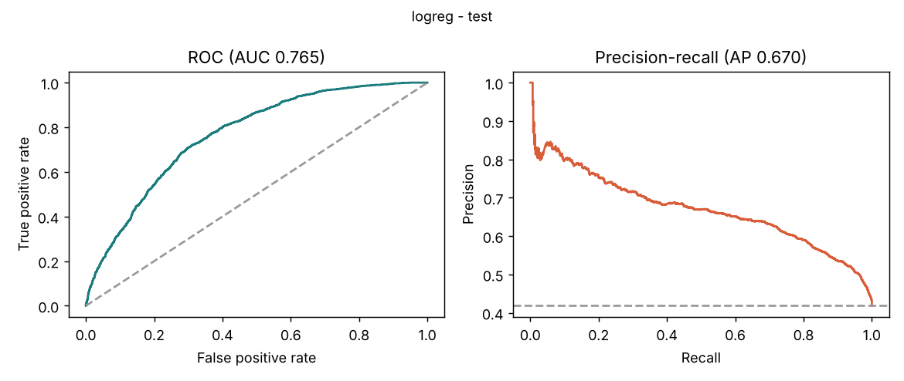
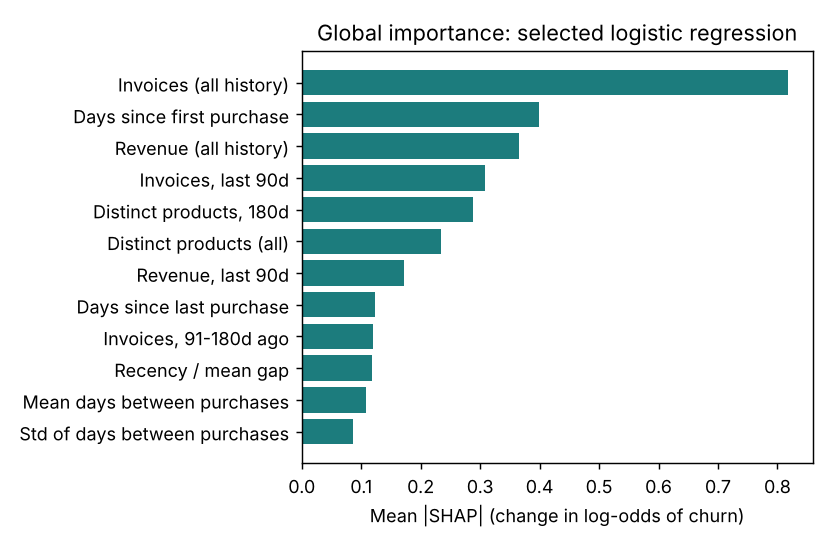

# Model Validation Report: 90-Day Customer Churn Model (v1.0.0)

**Project:** Retail Analytics Decision Support Platform (Online Retail II) · **Course:** BAN 6800, Nexford University · **Author:** Bezzel Chitsungo (MSc Data Analytics) · **Model:** `churn_logreg` v1.0.0 · **Status:** draft for submission. The AI Disclosure Form, the rubric and the protected-attribute definition were not supplied, so compliance with them is **pending** (Appendix A).

## 1. Purpose and business need

The Module 1 charter set a retention target: a five-percentage-point rise in repeat purchases within twelve months. Marketing currently builds campaigns from RFM segments, which describe past value but do not rank who is about to lapse. A churn-risk score gives retention planners a ranked list to review before they spend offer budget.

The model is decision *support*. It ranks identified customers for human-reviewed retention planning. It must not drive automated decisions about individuals, and it says nothing about unidentified (guest) customers or those inactive for more than 180 days.

## 2. Task definition and data

The dataset is the Module 3 published fact table (build `41afeb4d5b118509`), which holds pseudonymised customer keys. Pseudonymised data is pseudonymous, not anonymous, and is treated as personal data throughout.

**Task (all windows PROPOSED).** The Module 2 plan left the churn window "to be agreed with Marketing". I propose the following until that agreement exists, and every result below depends on it. At a monthly prediction date *T*, an identified customer is eligible if they placed at least one sales invoice in the 180 days before *T*. The label is churn = 1 when the customer places **no sales invoice in the 90 days from T**. Features use only data before *T*.

**Target construction and censoring.** Data end on 9 December 2011, so the last prediction date with a complete 90-day outcome window is 1 September 2011. Later dates are never created. Incomplete follow-up is therefore never labelled as churn. The result is 47,933 customer-snapshot rows from 5,212 customers over 16 monthly dates. Rows from the same customer are not independent, so splits, bootstrap intervals and cross-validation respect time and customer clustering.

**Features.** There are 18 behavioural features: recency, tenure, invoice counts over several windows, revenue over several windows, product breadth, purchase-gap statistics, and cancellation history. Country, the customer key and the snapshot date are excluded from the predictors and kept only for evaluation. Three gap features are missing for customers with a single invoice (26% to 43% of rows) and are imputed with training medians inside the pipeline.

## 3. Evaluation protocol and leakage controls

| Split | Prediction dates | Rows | Customers | Churn rate |
|---|---|---|---|---|
| Train | Jun–Dec 2010 | 20,584 | 4,225 | 0.483 |
| Validation | Mar–Apr 2011 | 6,637 | 3,584 | 0.569 |
| Test | Aug–Sep 2011 | 5,534 | 2,968 | 0.418 |

*Table 1. Time-ordered splits. Gaps equal the 90-day horizon so an outcome window never overlaps the next split.*

Time-ordered splits stop the model from learning from the future. Hyperparameters were searched with randomised search (25 draws, ROC-AUC) over four expanding-window folds inside the training period, with a three-month purge between fold train and fold validation. Imputation, scaling, class weighting and tuning are fitted inside each training fold only. Automated tests perturb every invoice dated on or after *T* and confirm that features do not change, and confirm that the label flips when a future purchase is added.

The selection rule was fixed in advance: take the highest validation AUC; if a more interpretable candidate is within 0.005 AUC, prefer it (logistic regression, then LightGBM, then random forest); then apply a fairness gate on validation. The threshold maximises F1 on validation. The test period was scored once per iteration, never used for tuning, and is disclosed in Section 7.

## 4. Models and results

I compared two baselines and three candidates. The prevalence baseline flags everyone. The business baseline is a recency rule (the longer since the last purchase, the higher the risk), chosen to represent what a planner would do without a model.

| Model | Validation AUC | Test AUC (95% CI) | Test PR-AUC | Test F1 | Test Brier |
|---|---|---|---|---|---|
| Prevalence | 0.500 | 0.500 | 0.418 | 0.590 | 0.247 |
| Recency rule | 0.690 | 0.663 (0.646–0.680) | 0.577 | 0.591 | 0.246 |
| **Logistic regression (selected)** | 0.775 | **0.765 (0.750–0.781)** | 0.670 | 0.674 | 0.193 |
| LightGBM | 0.774 | 0.768 (0.753–0.783) | 0.669 | 0.675 | 0.194 |
| Random forest | 0.774 | 0.769 (0.753–0.784) | 0.668 | 0.669 | 0.194 |

*Table 2. Validation and test performance. Intervals are customer-clustered bootstrap (95%). Thresholds were set on validation.*

The three candidates differ by less than 0.002 AUC on validation and their test intervals overlap almost completely, so they are statistically indistinguishable. The pre-declared interpretability rule therefore selects logistic regression, with `C = 0.376` and balanced class weights. It improves on the recency rule by about 0.10 AUC, and the intervals do not overlap. At the validation threshold of 0.314 the model has test precision 0.545 and recall 0.881 and flags 67.6% of customers. Mean predicted churn (0.425) matches the observed rate (0.418).

I report ROC-AUC because it measures ranking quality independently of any threshold, which is what a prioritised list needs. PR-AUC, precision, recall and F1 show the cost of acting on a particular cut-off, and the Brier score checks that the probabilities are usable as probabilities. Calibration is good on average, but I did not recalibrate the model, so the probabilities should be read as relative risk rather than guaranteed frequencies when the churn rate moves.

Cross-validation AUC inside the training period was lower (0.738, standard deviation 0.021) than on validation (0.775). That is expected rather than worrying: the earliest folds train on only one or two months of history, whereas the final model sees seven. The gap does mean the cross-validation figure should not be quoted as the expected performance.

The validation churn rate (0.569) is much higher than test (0.418). The F1-optimal threshold chosen on validation therefore flags more customers than needed on test. This is a documented limitation. Marketing should set the flag rate from campaign capacity, and Table 3 gives descriptive operating points (not tuned on test).

| Flag rate | Precision | Recall | Lift |
|---|---|---|---|
| 20% | 0.700 | 0.335 | 1.67 |
| 40% | 0.645 | 0.617 | 1.54 |
| 60% | 0.575 | 0.825 | 1.37 |

*Table 3. Test operating points at fixed flag rates (descriptive only).*

Performance is weaker for customers not seen in training (AUC 0.688, n = 963) than for returning customers (0.781, n = 4,571). The two test dates give 0.771 and 0.761. With a single time-aligned test window, I cannot say how the model behaves under a regime change.

## 5. Interpretability

SHAP values for the logistic regression were computed on the log-odds scale for 2,000 random test rows, with a 500-row training background.

Purchase frequency dominates. By group, frequency contributes 1.04, tenure 0.40, spend 0.33, product breadth 0.19, recency 0.12, regularity 0.08 and cancellations 0.05. Recency matters little on its own because "no invoices in the last 90 days" already encodes it. Customers with many past invoices and high revenue score as low risk. Two directions look counter-intuitive: longer tenure and more invoices in the last 30 days both raise predicted risk. These features are strongly nested and correlated with other features in the model, so single-feature directions are conditional and should not be read as causes.

A LightGBM model gives a different ordering (rank correlation 0.58, three of five top features shared). Importance rankings are therefore indicative, not exact.

Local explanations use five cases selected by a deterministic rule, not by hand. Case C is the most confident false positive (probability 0.84): a customer who usually buys every four days and had been silent for 161 days, then bought. Case D is the least confident missed churner (probability 0.036): 31 invoices and about £22,969 of lifetime revenue, who did not return. Strong history lowers average risk but never removes it.

**Counterfactuals.** I searched only mutable behaviour (extra invoices, up to six, and the date of the latest purchase) and held tenure, product breadth, gap statistics, cancellations and country fixed. No protected or inferred attribute was varied. Every counterfactual was re-scored through the pipeline. Both reported flagged cases flip below the threshold (0.589 to 0.245 with three extra invoices; 0.841 to 0.293 with five). Across 300 sampled flagged customers, 99.3% flip within six extra invoices, the median is three, and 16% need one. These describe the model's response to recorded behaviour, not what would cause a customer to stay.

**Sensitivity.** Monetary noise (σ up to 0.2) and recency shifts of ±7 days change AUC by at most 0.001. Randomly missing values in five features lower AUC by 0.002 (5%), 0.003 (10%) and 0.006 (20%). Removing cancellation history changes AUC by +0.001. The model is stable to measurement noise but this says nothing about behavioural drift.

## 6. Fairness assessment

**What the data can and cannot support.** The dataset contains no protected attributes (no age, sex, ethnicity, disability or similar), and I have not inferred any. Country is an operational field, not a protected attribute. The Module 1 charter nonetheless asks that country variables be examined for proxy effects and that subgroup recall and error rates stay within 10% of overall. I therefore use **UK versus non-UK** customers as a *supplementary, operational* grouping. This does **not** satisfy a protected-attribute fairness requirement, which remains **unmet and pending instructor clarification** (Appendix B). Positive prediction means "flagged for a retention offer".

An ablation shows the model does not need country: adding a UK flag changes validation AUC by 0.0002, so it is excluded.

The Module 1 band of 10% around overall subgroup performance, and the 0.80–1.25 disparate-impact band from Module 2, are governance thresholds chosen by this programme. They are not statistical tests and not legal tests. I therefore report each metric with an interval and read a breach as a prompt for review rather than proof of unfair treatment.

| Metric (test) | UK (n = 5,002) | Non-UK (n = 532) | Difference or ratio (95% CI) |
|---|---|---|---|
| Selection rate | 0.673 | 0.699 | DPD +0.026 (−0.025, 0.081) |
| Disparate impact ratio | – | – | 1.039 (0.963, 1.122) |
| True positive rate | 0.882 | 0.871 | −0.012 (−0.070, 0.048) |
| False positive rate | 0.520 | 0.595 | **+0.075 (0.009, 0.145)** |
| Equalised-odds difference | – | – | 0.075 |
| FPR / overall FPR | – | 1.127 | outside the 0.90–1.10 band |

*Table 4. Group fairness on test. DPD = demographic parity difference. Intervals are customer-clustered bootstrap.*

On validation the model passed the gate (disparate impact 1.007; TPR and FPR within 3% of overall), so no mitigation was triggered under the pre-declared rule. On test, selection rates and recall are comparable (disparate impact 1.039 sits inside the 0.80–1.25 band), but the non-UK false positive rate is 7.5 points higher and its interval just excludes zero. Non-UK customers are more often flagged without churning. Because a flag leads to an offer, the effect is unnecessary offers rather than denied benefits, but Marketing should confirm that reading. The non-UK group is small (532 rows), and per-country rates are unreliable: besides the UK, only Germany passes the minimum-sample rule, and the Fairness Metrics Report flags every other country as insufficient rather than interpreting it.

**Mitigation.** I tried threshold optimisation for equalised odds and Kamiran–Calders reweighing. Both were fitted on training and validation only. On test neither removed the gap (FPR ratios 1.199 and 1.142 against 1.127 unmitigated), and equalised-odds thresholds lowered recall to 0.755. They were reported as exploratory and **not adopted**. I do not claim the disparity is eliminated or that the model is fair. The residual finding is disclosed and monitored.

The practical meaning depends on how Marketing uses the flag. If a flag triggers a discount, non-UK customers receive slightly more unnecessary discounts. If a flag triggers a personal call from a limited team, the same pattern could crowd out other customers. This is why the recommendation below keeps a human in the loop and why the use decision belongs to Marketing and the AI Ethics Committee, not to the model.

## 7. Limitations and recommendation

1. The 90-day and 180-day windows are PROPOSED, not agreed.
2. Test was evaluated twice. Iteration 1 contained exactly collinear windows and fragile missing-value indicators, found by a collinearity check. Iteration 2 removed them. The decision was made on collinearity evidence, not test scores, but the test set is no longer untouched. Test AUC for the logistic regression was 0.767 (iteration 1) and 0.765 (iteration 2). The superseded runs are tagged in MLflow. The fairness mitigation experiments also computed exploratory test results; they informed nothing, but they are further looks at the test period.
3. Prevalence shifts between periods (0.57 validation, 0.42 test), so thresholds need recalibration.
4. One test window, weaker performance on new customers, and a small non-UK group.
5. The protected-attribute requirement cannot be assessed with this data.

**Recommendation.** Approve v1.0.0 for a supervised pilot only: ranked lists reviewed by a person, thresholds set by campaign capacity, no automated decisions. Before wider use, agree the churn window with Marketing, resolve the fairness-requirement question, and run the monitoring plan in the Model Card: weekly input drift and missingness, monthly AUC and calibration once outcomes mature, and quarterly UK/non-UK reviews by the AI Ethics Committee, which owns the model-bias risk (a principal concern in Module 1; owner per the Module 2 RAID log).

Outcomes take 90 days to mature, so performance monitoring necessarily lags. Input drift, the share of flagged customers and the proportion of missing gap features are therefore the early-warning signals. Review triggers (PROPOSED, to be agreed: for example, AUC below 0.70 on a matured month, a flag rate more than ten points from its pilot value, or any fairness metric outside its band for two consecutive reviews) send the model back for review and, if needed, retraining. Because the API logs no request bodies, these statistics must be computed by the calling system from its own scored batches; the API does not collect them.

---

## Appendix A. AI assistance and disclosure status

The analysis, code, tests and drafts were produced with assistance from Claude (Anthropic) in an interactive session. The author remains responsible for checking and submitting the work. The assignment's **AI Disclosure Form was not supplied**, so the form is **not completed** and compliance is **pending**. No statement here replaces it.

## Appendix B. Items awaiting instructor or stakeholder input

Which attributes the assignment treats as protected; whether UK versus non-UK is acceptable as a supplementary grouping; which fairness metrics the rubric expects for a churn classifier; Marketing's agreed churn window. A draft clarification request is in `docs/instructor_clarification_request_DRAFT.md` and has **not** been sent.

## References

- Information Commissioner's Office (2020) *Guidance on AI and data protection*. Wilmslow: ICO.
- Lundberg, S.M. and Lee, S.-I. (2017) 'A unified approach to interpreting model predictions', *Advances in Neural Information Processing Systems*, 30.
- Mitchell, M. et al. (2019) 'Model cards for model reporting', *Proceedings of FAT\* '19*, pp. 220–229.
- Tabassi, E. (2023) *Artificial Intelligence Risk Management Framework (AI RMF 1.0)*. NIST AI 100-1. Gaithersburg, MD: NIST.
- Kamiran, F. and Calders, T. (2012) 'Data preprocessing techniques for classification without discrimination', *Knowledge and Information Systems*, 33(1), pp. 1–33.
- Hardt, M., Price, E. and Srebro, N. (2016) 'Equality of opportunity in supervised learning', *Advances in Neural Information Processing Systems*, 29.
